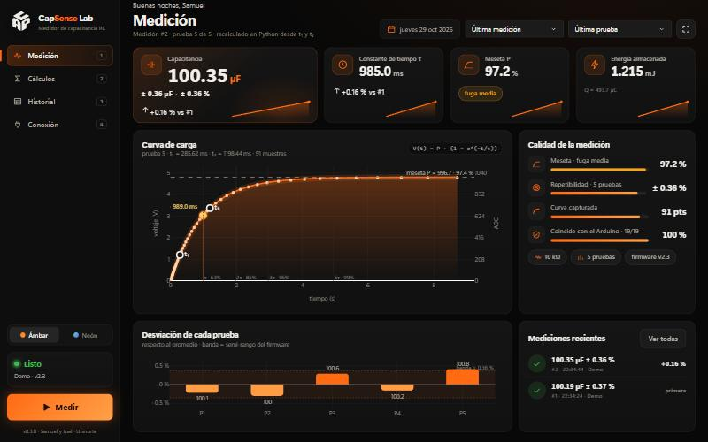
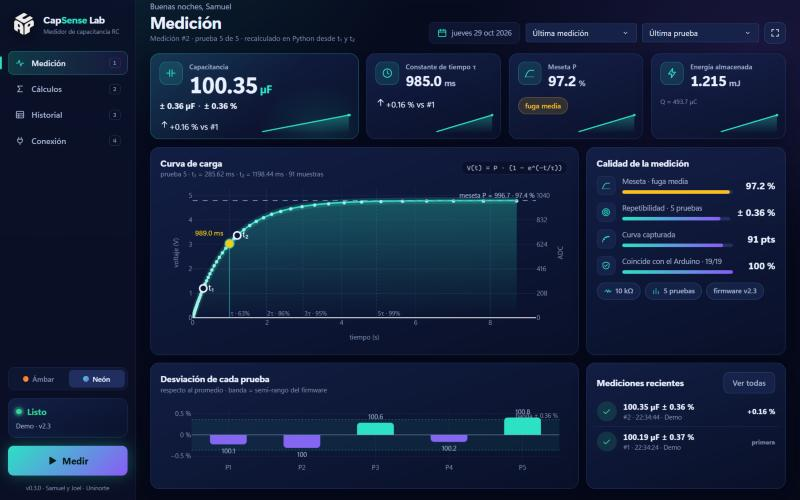
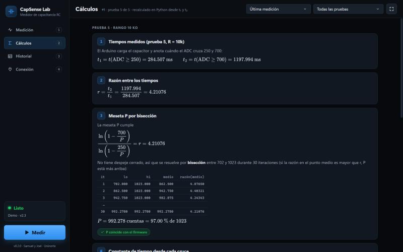

<p align="center"></p>

# CapSense Lab

Medidor de capacitancia RC (1 µF a 1000 µF) con Arduino Uno, y una aplicación de escritorio en Python para mostrar en proyector el resultado, la curva de carga y los cálculos paso a paso.

Proyecto de Samuel y Joel (Ingeniería de Sistemas, Universidad del Norte) para la GeoExpo de Física.





## Qué muestra

- **Resultado grande**, legible a 3 m: C con unidad automática (µF o mF), ± valor y ± %, rango usado (10 kΩ o 1 MΩ), número de pruebas, meseta y aviso rojo si la fuga es alta.
- **Curva de carga** interactiva: muestras reales (firmware v2.2), curva ajustada $V(t) = P(1-e^{-t/\tau})$, los cruces t₁ (ADC 250) y t₂ (ADC 700), la meseta punteada, τ (63.2 % de P) y guías en 2τ, 3τ y 5τ. Eje secundario en cuentas del ADC. Cada prueba por separado o todas superpuestas.
- **Cálculos paso a paso** con los números de la medición sustituidos: razón t₂/t₁ → bisección para P → τ₁, τ₂ → τ → C → promedio → incertidumbre → Q y E. Python recalcula todo desde t₁ y t₂ y marca **✓ coincide con el firmware** o la diferencia.
- C de cada prueba con la media y la banda de incertidumbre, tarjetas con τ, R, V, Q y E, historial de la sesión y exportación CSV.



## Diseño

Dos temas que se cambian desde la barra lateral (o con `[ui] tema` en `config/capsense.toml`):

- **Ámbar**: negro carbón con naranja.
- **Neón**: azul profundo con turquesa y violeta, tarjetas tipo vidrio.

El logo es un cubo isométrico con las letras **C**, **A** y **P** recortadas en sus tres caras (`scripts/generar_logo.py`).

La vista **Medición** muestra tarjetas con mini-gráficas y la comparación con la medición anterior, la curva de carga con brillo, un panel de *Calidad de la medición* (meseta, repetibilidad, curva capturada y coincidencia con el Arduino), la desviación de cada prueba y las mediciones recientes. **Historial** agrega un mapa de calor de repetibilidad.

El estilo sigue la skill [ui-ux-pro-max](https://github.com/nextlevelbuilder/ui-ux-pro-max-skill): **Dark Mode (OLED) + Data-Dense Dashboard + Real-Time Monitoring**, con el par tipográfico *Dashboard Data* (sans para etiquetas, monoespaciada para los valores), íconos SVG en vez de emojis, estados con texto además de color, foco visible con teclado y respeto por `prefers-reduced-motion`.

## Instalación

Requiere Python 3.10 o más reciente. En Windows la ventana usa WebView2 (incluido en Windows 11).

```bash
git clone https://github.com/samuelpabuena2008/capsense-lab.git
cd capsense-lab
python -m venv .venv
.venv\Scripts\activate
pip install -e ".[dev]"
```

En Linux o macOS, activa el entorno con `source .venv/bin/activate`.

## Uso

Doble clic en **`CapSense Lab.pyw`**: se abre la aplicación en su propia ventana (sin consola ni navegador). También:

```bash
python -m capsense --demo
```

La app tiene cuatro vistas en la barra lateral: **Medición**, **Cálculos**, **Historial** y **Conexión** (fuente de datos, simulador y consola serie). El estado del equipo y el botón **Medir** quedan siempre visibles.

| Tecla | Acción |
|---|---|
| `M` | Medir |
| `1` a `4` | Cambiar de vista |
| `F11` | Pantalla completa (para el proyector) |

Otras formas de arrancar:

| Comando | Qué hace |
|---|---|
| `python -m capsense --demo` | Simulador: no necesita Arduino. Sirve para practicar y de respaldo el día de la expo. |
| `python -m capsense --port auto` | Arduino real, autodetecta el puerto. |
| `python -m capsense --port COM3 --baud 9600` | Arduino con el firmware v2.1. |
| `python -m capsense --replay logs/sesion_..._serial.log` | Reproduce una sesión guardada (log serial o `*_pruebas.csv`). |
| `python -m capsense --navegador` | Abre en el navegador en vez de la ventana de la app. |
| `python -m capsense --servidor --host 0.0.0.0` | Solo el servidor, para abrirlo desde otro equipo de la red. |

Todo eso también se elige en la vista **Conexión**. Tras `pip install -e .` existe además el comando `capsense-app`, que abre la ventana sin consola. Opciones: `python -m capsense --help`.

### En el Arduino

- **Firmware v2.3** ([firmware/capsense_lab_v2_3](firmware/capsense_lab_v2_3/capsense_lab_v2_3.ino)), recomendado: igual que la v2.2, pero detecta t₁ y t₂ con una media móvil y los interpola. En el simulador baja el peor error de ~5 % a menos de 1 %.
- **Firmware v2.2** ([firmware/capsense_lab_v2_2](firmware/capsense_lab_v2_2/capsense_lab_v2_2.ino)): manda la curva real, t₁ y t₂, y acepta el botón **Medir** del dashboard (envía `M` por serie). 115200 baud. Mide igual que la v2.1.
- **Firmware v2.1**: también funciona (9600 baud). Se mide con el botón START; el dashboard reconstruye t₁ y t₂ desde τ y P y dibuja la curva ajustada.

Las constantes del montaje (V de entrada, resistencias, R del pin) están en [config/capsense.toml](config/capsense.toml) y deben coincidir con las del firmware. Si no coinciden, el dashboard muestra un aviso.

## Estructura

```
src/capsense/
├── domain/      modelos, física (réplica del firmware) y pasos de cálculo — sin serial ni UI
├── io/          parser del protocolo y fuentes: serial, simulador, replay
├── services/    sesión (estado, hilo seguro) y logs/exportación
├── ui/          Dash: layout, callbacks, gráficas, fórmulas, estilo, íconos SVG
└── desktop.py   ventana de escritorio (pywebview) con el servidor en un hilo
firmware/        capsense_lab_v2_1, v2_2 y v2_3
tests/           unit/, integration/, fixtures/
docs/            arquitectura, protocolo serie, cálculos
scripts/         grabar un log del Arduino, regenerar fixtures
```

Más detalle en [docs/arquitectura.md](docs/arquitectura.md), [docs/protocolo_serial.md](docs/protocolo_serial.md) y [docs/calculos.md](docs/calculos.md).

## Tests

```bash
pytest
pytest -m "not lento"
ruff check src tests
```

`pytest -m "not lento"` omite el barrido de 1 a 1000 µF.

## Solución de problemas

| Problema | Qué hacer |
|---|---|
| "No encuentro ningún Arduino" | Revisa el cable USB (algunos solo cargan). Pulsa ↻ para buscar puertos. |
| "COMx está ocupado" | Cierra el Monitor Serie del IDE de Arduino: solo un programa puede usar el puerto. |
| Llegan caracteres raros o nada | Los baudios no coinciden: 115200 para v2.2, 9600 para v2.1. |
| El botón Medir está apagado | Con la v2.1, en replay o mientras mide no se puede. Usa START en el Arduino. |
| Aviso de calibración distinta | `config/capsense.toml` y el firmware tienen valores diferentes. Corrige uno de los dos. |
| Se soltó el cable | El dashboard reintenta solo (1, 2, 4, 8 s). La medición en curso queda marcada como interrumpida. |
| Sin internet en la expo | No hace falta: Dash, Plotly, MathJax y las fuentes (Segoe UI Variable, Cascadia Code) están en tu PC. |
| La ventana no abre | Falta WebView2 (viene con Windows 11 y Edge). La app cae sola al navegador; también puedes usar `--navegador`. |
| Fórmulas sin formato | Recarga la página (F5). |

## Exactitud

Con el simulador, la v2.1/v2.2 llega a +5 % con capacitores de 1 a 5 µF con fuga y a −1.6 % con capacitores grandes y ruido. La v2.3 deja todo el rango bajo 1 %. El panel demo permite elegir qué firmware simular para comparar. Tabla completa en [docs/calculos.md](docs/calculos.md#9-exactitud-del-firmware-medida-con-el-simulador).
