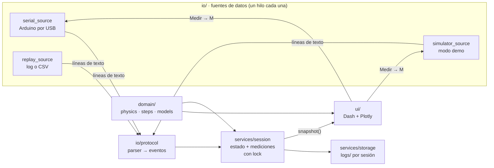
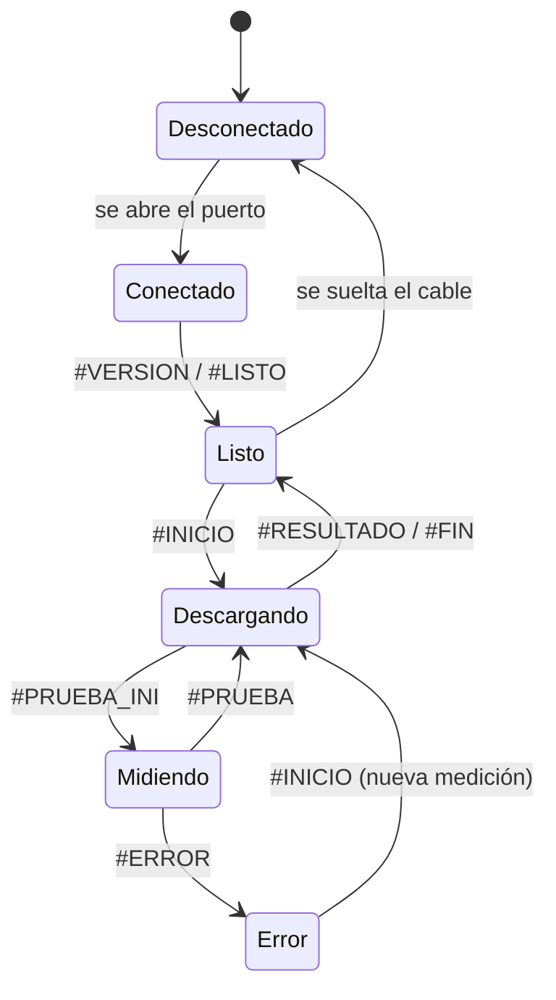

# Arquitectura

El dashboard está separado en capas. Cada capa solo conoce a la de abajo, así la matemática se prueba sin hardware y la interfaz no sabe si los datos vienen del Arduino, del simulador o de un archivo.

## Capas

| Capa | Archivos | Qué hace | Depende de |
|---|---|---|---|
| Dominio | `domain/models.py`, `physics.py`, `steps.py` | Dataclasses, réplica de la matemática del firmware y los pasos con números sustituidos. Sin serial ni UI. | nada |
| Entrada | `io/base.py`, `protocol.py`, `*_source.py` | Las tres fuentes entregan **texto línea por línea**, como el puerto serie. El parser lo convierte en eventos. | dominio |
| Servicios | `services/session.py`, `storage.py` | Estado del equipo, ciclo de vida de cada medición, historial y logs. | dominio, entrada |
| Interfaz | `ui/app.py`, `layout.py`, `callbacks.py`, `figures.py`, `formulas.py` | Página Dash. Lee la sesión cada 400 ms y solo redibuja si cambió `version`. | todas |

## Hilos

- Cada fuente corre en su propio hilo `daemon` y llama a `Session.recibir_linea()`.
- `Session` protege todo con un único `RLock`. La interfaz pide `snapshot()`, que devuelve copias.
- Las `Run` no se modifican después de agregarse a una medición (los t1/t2 de la v2.1 se reconstruyen antes, dentro del lock).

## Estados del equipo

Con el firmware v2.1 no hay `#PRUEBA_INI`: el estado pasa a *Midiendo* con la cabecera de la tabla y a *Listo* con la línea CSV del resultado.

## Archivos que genera una sesión

En `logs/` (fuera de git):

- `sesion_AAAAMMDD_HHMMSS_serial.log`: todo lo recibido, con marca de tiempo. Se puede reproducir con `--replay`.
- `sesion_..._mediciones.csv`: una fila por medición (el historial).
- `sesion_..._pruebas.csv`: una fila por prueba, con t1 y t2. También se puede reproducir.
- `capsense.log`: log de la aplicación (rotativo, 1 MB × 3).
